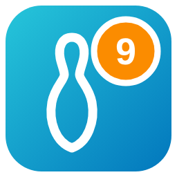
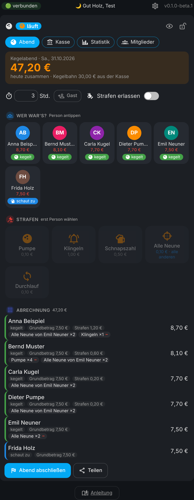

# 🎳 Bowling club (Kegelclub) for Home Assistant

🇩🇪 **Deutsch?** → [README auf Deutsch](README.md)

**No more paper lists at the bowling alley.** Book fines with one tap, the bill calculates itself, and the club cash always knows who still owes what. In the dashboard, in the sidebar and as a phone app that also works offline.

One click opens it right in your Home Assistant: [](https://my.home-assistant.io/redirect/hacs_repository/?owner=misterm2310&repository=kegelclub-card&category=integration) [](https://my.home-assistant.io/redirect/config_flow_start/?domain=kegelclub)



> 🔒 **Your data stays with you.** Everything lives only in your Home Assistant. No cloud. This repo only contains made-up sample data.

---

## ✨ Features

- 🎳 **Bowling evening**: tap a person, tap a fine, done. Every tap = +1, with ↩️ undo.
- 👥 **Five states**: bowling · watching · left early · excused · no-show – plus **guests** with the same rules.
- 💸 **Your own list of fines**: name, icon, amount and **who pays** – the thrower or **all others who are bowling** (e.g. “all nine”).
- 🧮 **Rules are settings**: base fee, watchers pay yes/no, absent members pay yes/no, extra for no-shows, lane per hour (from the cash, split or off). Fits any club.
- 🙌 **Waive fines** for trips, Christmas parties & co.
- 🏦 **Club cash** with “who owes what”, payments, expenses and CSV.
- 📊 **Statistics** (one year or all years): overview with previous-year comparison and records, kings, cash history · people with their own detail page · evening-by-evening table · fines by type and a "who got what" matrix.
- 📤 **Print & share**: print an evening's bill, share a real PDF (iPhone: Share → Print), QR code for phones or plain text. 📸 Member photos.
- 🏠 **About the club**: name, founding date (with a greeting on the anniversary), lane, schedule, notes. ✉️ E-mail per member and “Mail everyone”. 💡 Keep the screen on during the evening.
- 📥 **Move from the “Alle Neune” app** – with all old evenings, fines and the complete cash.
- 📱 **Offline app**, 🔒 **PIN lock** (unlocking also works offline), 💾 **backup**, 📜 **history**.
- 🌍 **German or English** (automatic, like Home Assistant) and 💱 **selectable currency**.

---

## 📦 Installation

1. Open **HACS**, top right **⋮ → Custom repositories**, add `https://github.com/misterm2310/kegelclub-card`, type **Integration**.
2. Search **Kegelclub**, **Download**, then **restart Home Assistant**.
3. **Settings → Devices & services → Add integration → Kegelclub** → name of the club → Submit. 🎉
4. Dashboard → **Edit → Add card → Kegelclub**.

> 🆕 **From Home Assistant 2026.11:** you find HACS under **Settings → Marketplace**.

```yaml
type: custom:kegelclub-card
```

<details><summary>Without HACS (manual)</summary>

Copy `custom_components/kegelclub` to `/config/custom_components/kegelclub` and restart Home Assistant. Then continue with step 3.
</details>

---

## 👆 How to use it

<details><summary>First start, bowling evening, cash – <i>expand</i></summary>

1. **First start**: the card asks how you want to start – **empty**, with **sample fines** or with the **file from “Alle Neune”**.
2. Add **members** (⚙️ → **Members & fines**, photos too) and set base fee and lane under ⚙️ → **Rules & amounts**.
3. **Start bowling evening**. The small button under each person switches: bowling → watching → 🚪 left early → excused → no-show.
4. **Book a fine**: tap the person first, then the fine.
5. **Close evening** → the bill goes to the **cash** under “who owes what”. Paid? Tap the green check.

More in the card under **📖 Guide** (with search).
</details>

<details><summary>📥 Move from “Alle Neune” – <i>expand</i></summary>

Export the data in the “Alle Neune” app (database file, `.db`), then in the card ⚙️ → **Import & backup** → choose the file. You get a **preview** first; nothing changes until **“Apply”**. Members, former members, guests, fines with prices, all evenings and the complete cash are taken over. Old evenings don't count as open – they were already settled in the app. Games are not taken over. Not affiliated with “Alle Neune”; the import only reads its export file.
</details>

<details><summary>🤖 Sensors and actions – <i>expand</i></summary>

`sensor.kegelclub_kegelkasse` (cash), `sensor.kegelclub_offen` (open, attribute `personen`), `sensor.kegelclub_letzter_abend`, `sensor.kegelclub_abende`, `binary_sensor.kegelclub_abend_laeuft`.
Actions: `kegelclub.strafe_buchen`, `kegelclub.abend_starten`, `kegelclub.abend_abschliessen`, `kegelclub.einzahlung`, `kegelclub.ausgabe`, `kegelclub.daten_abrufen`. With several clubs use the `club` field.
</details>

<details><summary>🎛️ Card options – <i>expand</i></summary>

```yaml
type: custom:kegelclub-card
title: Kegelclub   # optional
buch: Ladies       # optional: which club (empty = first club)
privat: true       # optional: show amounts only after tapping 👁️
language: en       # optional: de or en (default = like Home Assistant)
```
</details>

**⏳ When will the next beta come?** To be honest: I build these integrations with the help of Claude (AI). How fast new betas come depends on how much Claude quota (tokens) is available. Once it is used up, I have to wait until it is refilled – no tokens, no betas. 😅 Thank you for your patience and understanding! 🙏

---

## 💙 Like it?

It is and stays **free**. If you like, you can send me a small donation via PayPal – completely voluntary: [paypal.me/MarcoStrickmann](https://paypal.me/MarcoStrickmann). The link is also under ⚙️ → Credits. The next round is on you. 🍻

[](https://paypal.me/MarcoStrickmann)

Ideas → [Discussions](https://github.com/misterm2310/kegelclub-card/discussions) · Bugs → [Issues](https://github.com/misterm2310/kegelclub-card/issues) (please no real club data).

License: MIT · by [Mister-M](https://github.com/misterm2310) · Icons: [Material Design Icons](https://pictogrammers.com) (Apache 2.0)
