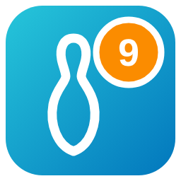
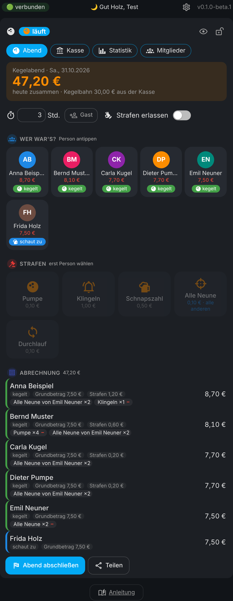

# 🎳 Kegelclub für Home Assistant

🇬🇧 **English?** → [README in English](README.en.md)

**Schluss mit Zettelwirtschaft auf der Kegelbahn.** Strafen per Fingertipp, die Abrechnung rechnet sich selbst, und die Kegelkasse weiß immer, wer noch was schuldet. Im Dashboard, in der Seitenleiste und als eigene Handy-App, die auch ohne Netz geht.

Ein Klick öffnet es direkt in deinem Home Assistant: [](https://my.home-assistant.io/redirect/hacs_repository/?owner=misterm2310&repository=kegelclub-card&category=integration) [](https://my.home-assistant.io/redirect/config_flow_start/?domain=kegelclub)



> 🔒 **Eure Daten bleiben bei euch.** Alles liegt nur in deinem Home Assistant. Keine Cloud, kein fremder Server. In diesem Repo stehen nur ausgedachte Beispieldaten.

---

## ✨ Was kann das Ding?

- 🎳 **Kegelabend**: Person antippen, Strafe antippen, fertig. Jeder Tipp = +1, mit **−** und ↩️ Rückgängig, dazu **eigene Strafen** per Hand.
- 💶 **Kassieren am Tisch**: Grundbetrag am Anfang, Strafen per Münze in der Abrechnung.
- 👥 **Fünf Zustände**: kegelt · schaut zu · gegangen (zahlt danach keine Neuner der anderen) · abgemeldet · nicht abgemeldet – dazu **Gäste** mit den gleichen Regeln.
- 💸 **Eigenes Sündenregister**: Name, Symbol, Betrag und **wer zahlt** – er selbst oder **alle anderen, die mitkegeln** (z. B. „Alle Neune“).
- 🧮 **Regeln als Einstellung**: Grundbetrag, Zuschauer zahlen ja/nein, Fehlende zahlen ja/nein, Extra bei „nicht abgemeldet“, Kegelbahn pro Stunde (aus der Kasse, aufgeteilt oder aus). Passt so für jeden Club.
- 🙌 **Strafen erlassen** für Ausflug, Weihnachtsfeier & Co.
- 🏦 **Kegelkasse** mit „Wer schuldet was“, Einzahlungen, Ausgaben und CSV.
- 📊 **Statistik** (ein Jahr oder alle Jahre): Überblick mit Vergleich zum Vorjahr und Rekorden, Könige, Kasse-Verlauf · Personen mit eigener Detailseite · Tabelle Abend für Abend · Strafen nach Art und „Wer hat was?“-Tabelle.
- 📤 **Drucken & Teilen**: Abrechnung eines Abends drucken, als echte PDF teilen (iPhone: Teilen → Drucken), als QR-Code fürs Handy oder als Text. 📸 Fotos für Mitglieder.
- 🏠 **Über den Club**: Name, Gründung (mit Glückwunsch am Jahrestag), Bahn, Termin, Notizen. ✉️ E-Mail je Mitglied und „Mail an alle“. 💡 Bildschirm bleibt beim Kegelabend an.
- 📥 **Umzug aus der App „Alle Neune“** – mit allen alten Abenden, Strafen und der kompletten Kasse.
- 📱 **Offline-App** für die Kegelbahn, 🔒 **PIN-Sperre** (entsperren klappt auch ohne Netz), 💾 **Sicherung**, 📜 **Verlauf**.
- 🌍 **Deutsch oder Englisch** (automatisch wie Home Assistant) und 💱 **Währung wählbar**.

---

## 📦 Installation

1. **HACS** öffnen, oben rechts **⋮ → Benutzerdefinierte Repositories**, `https://github.com/misterm2310/kegelclub-card` eintragen, Typ **Integration**, **Hinzufügen**.
2. Nach **Kegelclub** suchen, **Herunterladen**, danach **Home Assistant neu starten**.
3. **Einstellungen → Geräte & Dienste → Integration hinzufügen → Kegelclub** → Name des Clubs → Absenden. 🎉
4. Dashboard → **Bearbeiten → Karte hinzufügen → Kegelclub**.

> 🆕 **Ab Home Assistant 2026.11:** HACS findest du unter **Einstellungen → Marketplace**.

```yaml
type: custom:kegelclub-card
```

> 🙌 Eine Ressource musst du **nicht** von Hand eintragen, das macht die Integration selbst.

<details><summary>Ohne HACS (von Hand)</summary>

Den Ordner `custom_components/kegelclub` nach `/config/custom_components/kegelclub` kopieren und Home Assistant neu starten. Dann weiter mit Schritt 3.
</details>

---

## 👆 So wird's benutzt

<details><summary>Erster Start, Kegelabend, Kasse – <i>aufklappen</i></summary>

1. **Erster Start**: Die Karte fragt, wie ihr starten wollt – **leer**, mit **Beispiel-Strafen** oder mit der **Datei aus „Alle Neune“**.
2. **Mitglieder** anlegen (⚙️ → **Mitglieder & Strafen**, dort auch Fotos) und unter ⚙️ → **Regeln & Beträge** Grundbetrag und Kegelbahn einstellen.
3. **Kegelabend starten**. Der kleine Knopf unter jeder Person schaltet weiter: kegelt → schaut zu → 🚪 gegangen → abgemeldet → nicht abgemeldet.
4. **„Grundbetrag kassiert“** antippen, wenn am Anfang alle bezahlt haben.
5. **Strafe buchen**: erst die Person, dann die Strafe antippen. Das rote **−** oben links nimmt eine zurück, **„Eigene“** = Betrag und Grund selbst eintippen.
6. Zum Schluss in der **Abrechnung** auf die **Münze** tippen, wenn jemand seine Strafen bezahlt hat.
7. **Abend abschließen**. Wer noch offen ist, landet unter „Wer schuldet was“. Die Kegelbahn wird jetzt aus der Kasse gebucht.

Alles Weitere steht in der Karte unter **📖 Anleitung** (mit Suche).
</details>

<details><summary>🧮 Beispiel-Rechnung – <i>aufklappen</i></summary>

Grundbetrag 7,50 €, Pumpe 0,10 €, „Alle Neune“ 0,10 € (alle anderen zahlen). Anna, Bernd und Carla kegeln, Dieter schaut zu.

- Anna wirft 3 Pumpen und 1 Neun → Anna: 7,50 + 0,30 = **7,80 €** (ihre Neun zahlt sie nicht)
- Bernd und Carla zahlen Annas Neun mit → je 7,50 + 0,10 = **7,60 €**
- Dieter schaut zu → **7,50 €** (Neuner zahlen nur Mitkegler)

</details>

---

## 📥 Umzug aus „Alle Neune“

<details><summary>So kommen eure alten Daten rüber – <i>aufklappen</i></summary>

1. In der App **„Alle Neune“** die Daten exportieren (Datenbank-Datei, `.db`).
2. In der Karte ⚙️ → **Import & Sicherung** → Datei wählen.
3. Erst kommt eine **Vorschau** (Club, Mitglieder, Ehemalige, Gäste, Strafen, Abende, Kassenstand). Geändert wird erst nach **„Übernehmen“**.

Übernommen werden Mitglieder, Ehemalige, Gäste, Strafen mit Preisen (aus „X (Andere)“ wird „alle anderen zahlen“), alle Abende mit allen Strafen und die **komplette Kasse**. Alte Abende zählen **nicht** als offen, die waren in der App ja schon abgerechnet. Spiele werden nicht übernommen.

> Der Kegelclub ist nicht mit der App „Alle Neune“ verbunden – der Import liest nur deren Export-Datei.
</details>

---

## 📱 Offline-App

<details><summary>Für die Kegelbahn mit schlechtem WLAN – <i>aufklappen</i></summary>

Adresse steht in der Karte unter ⚙️ → **Offline-App** (`/kegelclub/app/`). Im Handy-Browser öffnen, mit dem Home-Assistant-Benutzer anmelden, **„Zum Startbildschirm hinzufügen“**.
Ohne Netz läuft alles weiter: Was du buchst, wartet im Postausgang und wird nachgeschickt. Nichts zählt doppelt, auch wenn zwei Handys gleichzeitig buchen. Für unterwegs braucht es eine **https**-Adresse (z. B. Nabu Casa).
</details>

---

## 🎛️ Karten-Optionen

<details><summary>Was du im YAML der Karte einstellen kannst – <i>aufklappen</i></summary>

```yaml
type: custom:kegelclub-card
title: Kegelclub   # optional
buch: Damenclub    # optional: welcher Club (leer = erster Club), auch im Karten-Editor wählbar
privat: true       # optional: Beträge erst nach Antippen von 👁️ zeigen
language: en       # optional: de oder en (ohne = wie Home Assistant)
```

</details>

---

## 🤖 Für Automationen

<details><summary>Sensoren und Aktionen – <i>aufklappen</i></summary>

| Entität | Was |
|---|---|
| `sensor.kegelclub_kegelkasse` | Kassenstand (Attribute: offen, Soll, Kegelbahn gesamt, Abende) |
| `sensor.kegelclub_offen` | Was noch offen ist (Attribut `personen`: wer wie viel) |
| `sensor.kegelclub_letzter_abend` | Datum des letzten abgeschlossenen Abends |
| `sensor.kegelclub_abende` | Anzahl Abende |
| `binary_sensor.kegelclub_abend_laeuft` | an, solange ein Kegelabend läuft |

Aktionen: `kegelclub.strafe_buchen`, `kegelclub.abend_starten`, `kegelclub.abend_abschliessen`, `kegelclub.einzahlung`, `kegelclub.ausgabe`, `kegelclub.daten_abrufen` (gibt alles als Antwort zurück). Bei mehreren Clubs gibt es das Feld `club`.

Beispiel: Erinnerung, wenn um Mitternacht noch ein Abend offen ist.

```yaml
alias: Kegelabend nicht abgeschlossen
description: Erinnert kurz nach Mitternacht, wenn der Kegelabend noch offen ist.
triggers:
  - trigger: time
    at: "00:30:00"
conditions:
  - condition: state
    entity_id: input_boolean.schalter_wartung
    state: "off"
  - condition: state
    entity_id: binary_sensor.kegelclub_abend_laeuft
    state: "on"
actions:
  - action: notify.notify
    continue_on_error: true
    data:
      message: "🎳 Der Kegelabend ist noch offen – bitte abschließen!"
```

</details>

---

## 🏠 Mehrere Clubs

<details><summary>Herren-, Damen-, Jugendclub … – <i>aufklappen</i></summary>

**Einstellungen → Geräte & Dienste → Kegelclub → Eintrag hinzufügen** und einen Namen geben. Jeder Club hat eigene Mitglieder, Strafen, Kasse, PIN und Sensoren (`sensor.kegelclub_<name>_…`). In der Karte wählst du ihn bei „Welcher Club?“.
</details>

**⏳ Wann kommt die nächste Beta?** Ehrlich gesagt: Ich baue die Integrationen mit Hilfe von Claude (KI). Wie schnell neue Betas kommen, hängt davon ab, wie viel Claude-Kontingent (Tokens) gerade frei ist. Ist es aufgebraucht, muss ich warten, bis es wieder aufgefüllt ist – keine Tokens, keine Betas. 😅 Danke für eure Geduld und euer Verständnis! 🙏

---

## 💙 Gefällt dir der Kegelclub?

Er ist und bleibt **kostenlos**. Wenn du magst, kannst du mir ganz freiwillig eine kleine Spende per PayPal schicken: [paypal.me/MarcoStrickmann](https://paypal.me/MarcoStrickmann). Den Link gibt es auch unter ⚙️ → Credits. Die nächste Runde geht auf dich. 🍻

[](https://paypal.me/MarcoStrickmann)

---

## 💡 Ideen, Wünsche und Fehler

- **Idee oder Wunsch?** Schreib sie bei den [Diskussionen](https://github.com/misterm2310/kegelclub-card/discussions).
- **Etwas funktioniert nicht?** Mach ein [Issue](https://github.com/misterm2310/kegelclub-card/issues) auf, mit deiner Version (oben rechts in der Karte). **Bitte keine echten Clubdaten mitschicken!**

---

## 🧪 Für Entwickler

<details><summary>Tests – <i>aufklappen</i></summary>

```bash
pip install -r requirements_test.txt
pytest
```

Dazu ein **Oberflächen-Test** im Browser (Abrechnung, Alle Neune, Strafen erlassen, Offline-Postausgang, Englisch, Offline-App): `cd tests/ui && npm install && npx playwright install chromium && node ui.test.mjs`.

</details>

Lizenz: MIT · von [Mister-M](https://github.com/misterm2310) · Symbole: [Material Design Icons](https://pictogrammers.com) (Apache 2.0)
